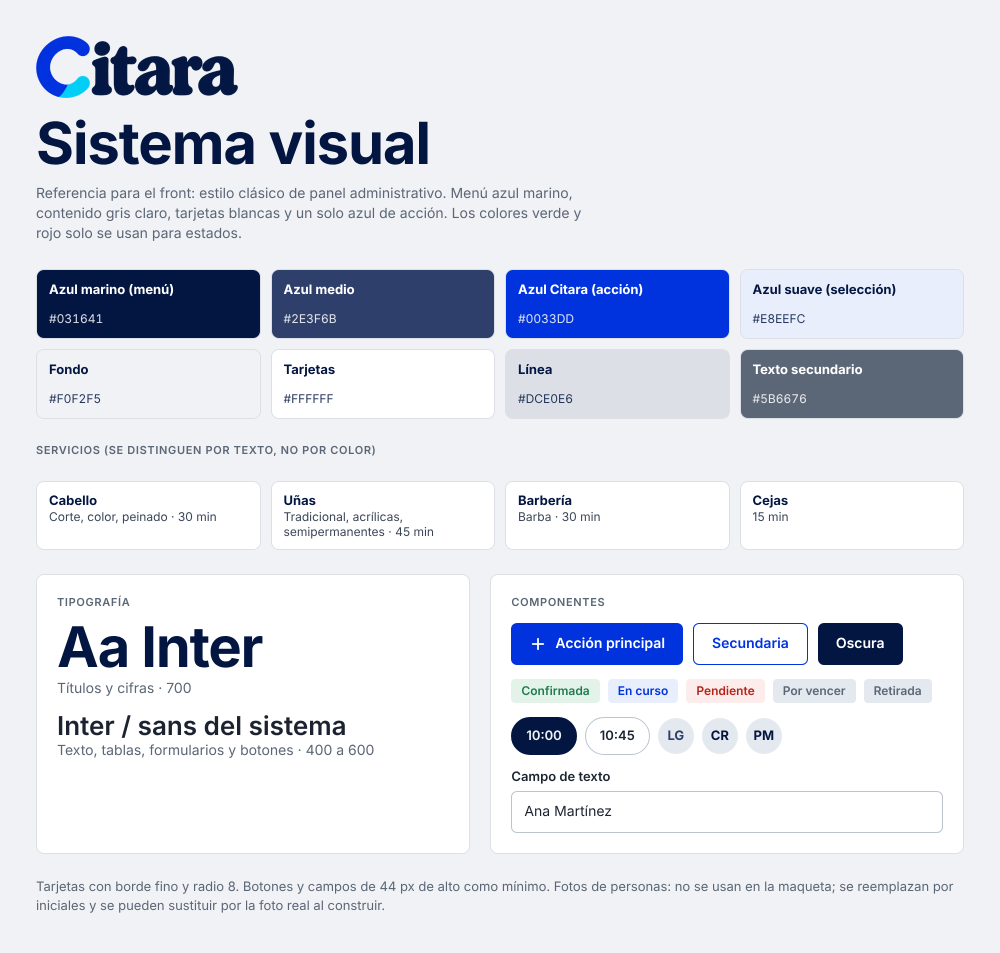

  

**Citara** es una plataforma SaaS para peluquerías, salones de uñas y barberías. Centraliza las reservas y conecta la agenda de cada trabajador con los servicios realizados, la factura, las comisiones, el inventario y los reportes, para que el dueño delegue la operación diaria y consulte resultados por trabajador y sede.

Proyecto final de Programación Avanzada.

## Qué incluye el sistema

- **Reservas** del cliente por enlace público, para cualquier cliente y con varios servicios por cita. Catálogo reducido: cabello (corte, color, peinado), uñas (tradicional, acrílicas, semipermanentes), barbería (barba) y cejas.
- **Duraciones fijas** (uñas 45 min, cabello y barba 30 min, cejas 15 min) y un **bot de asesoría por chat** para los casos que necesitan más tiempo.
- **Agenda de empleados** que se actualiza con cada cambio y se muestra en un **televisor del salón** (turno actual, tiempo restante y turnos del día), con varios turnos por día por empleado.
- **Factura** única por cita, con **historial de facturas** (sin integración con proveedor electrónico).
- **Comisiones y pagos** diarios, semanales, quincenales o mensuales, con descuento mensual por productos y ganancia por ventas del empleado.
- **Inventario** de venta, uso interno y dotación por área, con stock en bodega y en manos de cada empleado, y alerta de existencias bajas.
- **Finanzas** con ingresos por servicios y por productos, gastos, y ganancia bruta y neta.
- **Roles:** cliente, empleado, administrador y dueño.

## Contenido del repositorio

| Carpeta | Qué hay |
|---|---|
| [`docs/enunciado-profesora.md`](docs/enunciado-profesora.md) | Enunciado de la profesora: módulos exigidos, hallazgos de las entrevistas y referencias. |
| [`docs/levantamiento-de-informacion.md`](docs/levantamiento-de-informacion.md) | Levantamiento de información, decisiones del equipo (23 de noviembre), roles, supuestos y alcance. |
| [`docs/flujos-por-modulo.md`](docs/flujos-por-modulo.md) | Diagramas de flujo de los ocho módulos del enunciado, corregidos con las decisiones del 23 de noviembre. |
| [`docs/flujos-de-usuario.md`](docs/flujos-de-usuario.md) | Flujos de usuario corregidos de cliente, empleado, administrador y dueño (diagramas). |
| [`docs/flujo-por-panel.md`](docs/flujo-por-panel.md) | Flujo por panel: qué hace el usuario en cada pantalla y qué tablas lee y escribe. |
| [`docs/modelo-de-datos.md`](docs/modelo-de-datos.md) | Borrador del modelo de datos (diagrama entidad-relación) y reglas que debe garantizar. |
| [`docs/er/`](docs/er/) | Modelo entidad-relación completo y por módulos (PNG, SVG y script para regenerarlo). |
| [`design/Citara_Computador.pdf`](design/Citara_Computador.pdf) | Maquetación para computador: 35 pantallas (administración, dueño, televisor, formularios nuevos y expediente de 6 secciones). |
| [`design/Citara_Celular.pdf`](design/Citara_Celular.pdf) | Maquetación para celular: 9 pantallas (app del cliente y del empleado). |
| [`design/html/`](design/html/) | Las mismas pantallas en HTML, enlazadas entre sí (abrir `Clientes.html`, `Cliente_Nuevo.html`, `Empleado_Expediente.html`…). |
| [`docs/db/`](docs/db/README.md) | Script de la base de datos en MySQL 8 (multi-tenant): esquema de 43 tablas, reglas, vistas, aislamiento por negocio, datos de demo y pruebas. |
| [`assets/`](assets) | Logo de Citara e imagen del sistema visual. |

## Sistema visual

Estilo clásico de panel administrativo: menú azul marino (`#031641`), contenido gris claro, tarjetas blancas y un único azul de acción (`#0033DD`, el del logo). Verde y rojo se usan solo para estados. Los servicios se distinguen por texto, no por color. Tipografía sans (Inter) en toda la interfaz; el logo es lo único con serif.

> En los PDF los títulos pueden verse con una tipografía de reemplazo; el diseño final usa Inter.
