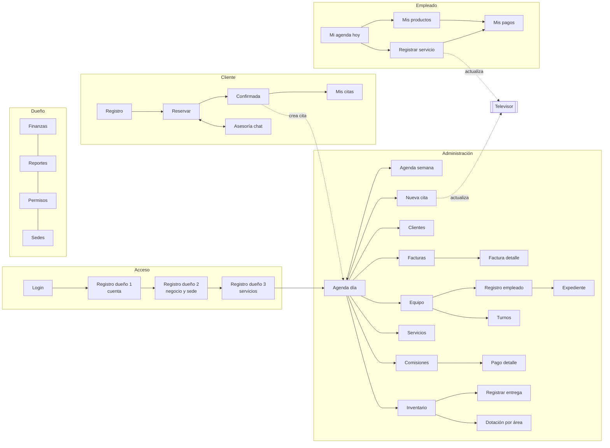
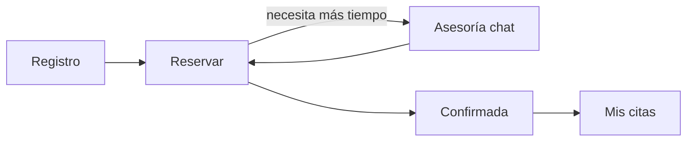

# Flujo por panel y tablas que usa cada uno

Cada panel de la maqueta ([`design/`](../design)) se describe con lo que el usuario hace en él y con las **tablas que lee y escribe**. Sirve para derivar el modelo de datos ([`modelo-de-datos.md`](modelo-de-datos.md)) y para repartir el trabajo del front y del back.

Convención: **L** = lee, **E** = escribe (crea o actualiza). Los nombres de tablas están en el [modelo de datos](modelo-de-datos.md).

## Mapa de navegación

## Acceso y registro del dueño

| Panel | Qué hace el usuario | Lee | Escribe |
|---|---|---|---|
| Login | Entra con correo y contraseña; elige reservar como cliente o registrar su negocio. | usuario | — |
| Registro del dueño 1 · Cuenta | Crea su cuenta: nombres, documento, celular, correo, contraseña. | — | usuario (rol dueño) |
| Registro del dueño 2 · Negocio y sede | Datos del negocio, primera sede y horario; sube los documentos del negocio. | — | negocio, sede, sede_horario, documento_negocio |
| Registro del dueño 3 · Servicios | Activa el catálogo para cualquier cliente, con precio: cabello (corte, color, peinado) 30 min, uñas (tradicional, acrílicas, semipermanentes) 45 min, barbería (barba) 30 min y cejas 15 min. | — | servicio |

## App del cliente (celular)

| Panel | Qué hace el usuario | Lee | Escribe |
|---|---|---|---|
| Cliente · Registro | Se registra con nombre, celular y correo. | — | cliente |
| Cliente · Reservar | Elige uno o varios servicios (por ejemplo corte y barba en una cita), profesional (o quién está libre) y horario. | servicio, empleado_servicio, turno_empleado, cita_servicio (disponibilidad) | cita, cita_servicio |
| Cliente · Asesoría por chat | Pide asesoría; el bot responde duración y empleados disponibles. Para uñas complicadas, el cliente escribe su caso. | asesoria_regla, empleado_servicio | asesoria_chat, asesoria_mensaje |
| Cliente · Reserva confirmada | Ve la factura de la cita con una línea por servicio. | cita, cita_servicio, factura | factura |
| Cliente · Mis citas | Consulta sus citas y el historial de facturas. | cita, cita_servicio, factura | — |

## Administración diaria

| Panel | Qué hace el usuario | Lee | Escribe |
|---|---|---|---|
| Agenda · Día | Ve los turnos de cada empleado, abre el detalle y marca los servicios realizados. | cita_servicio, empleado, cliente, factura | cita_servicio (estado) |
| Agenda · Semana | Vista semanal de la agenda por empleado. | cita_servicio, empleado | — |
| Nueva cita | Registra una reserva que llegó por chat, con uno o varios servicios de cualquier área; valida traslapes. | cliente, servicio, empleado_servicio, turno_empleado, cita_servicio | cita, cita_servicio, factura |
| Clientes | Lista y ficha del cliente con su historial. | cliente, cita, factura | cliente |

## Equipo, documentos y servicios

| Panel | Qué hace el usuario | Lee | Escribe |
|---|---|---|---|
| Equipo | Lista el equipo, su área, servicios habilitados, documentos, dotación y estado. | empleado, empleado_servicio | empleado (activo o retirado) |
| Empleado · Registro | Crea o actualiza datos personales, área, servicios habilitados, porcentaje de comisión y periodicidad de pago; entrega el kit de dotación de su área. | empleado, empleado_area, area_dotacion, comision_config | empleado, empleado_area, usuario, comision_config, entrega_interna |
| Empleado · Expediente | Sube y verifica los documentos de la Secretaría de Salud; ve su dotación entregada y el historial de servicios y pagos. | documento_requerido, empleado_documento, entrega_interna, cita_servicio, liquidacion | empleado_documento, entrega_interna (devolución) |
| Turnos | Asigna uno o varios turnos por día (por ejemplo mañana y tarde) según horario y servicios habilitados; impide turnos que se crucen. | empleado, empleado_servicio | turno_empleado |
| Servicios | Administra el catálogo, duraciones y quién puede hacer cada servicio. | servicio, empleado_servicio, asesoria_regla | servicio, empleado_servicio, asesoria_regla |

## Facturas y pagos

| Panel | Qué hace el usuario | Lee | Escribe |
|---|---|---|---|
| Facturas | Historial de facturas con filtros por fecha y cliente. | factura, cita, cliente | — |
| Factura · Detalle | Una factura por cita: cada servicio, su valor y su empleado. | factura, cita_servicio, empleado | — |
| Comisiones y pagos | Liquidación por empleado y periodo (diario, semanal, quincenal o mensual). | liquidacion, cita_servicio, comision_config | liquidacion, liquidacion_detalle |
| Pago · Detalle | Detalle de un pago: servicios, comisión, descuento por productos vendidos, uso personal y total; muestra la ganancia por ventas. | liquidacion, liquidacion_detalle, venta_producto | liquidacion (estado pagado) |

## Inventario, finanzas y permisos

| Panel | Qué hace el usuario | Lee | Escribe |
|---|---|---|---|
| Inventario | Separa productos de venta, dotación y uso interno; existencias en bodega y en manos de los empleados; alerta de venta con menos de cinco unidades en bodega. | producto, entrega_interna, area_dotacion | producto |
| Registrar entrega | Registra empleado, fecha y cantidad según el tipo: dotación del área (sin cobro), productos para vender (a precio de empleado) o uso interno. | producto, empleado | entrega_interna |
| Dotación por área | Define el kit de cada área y entrega o repone piezas a una persona. | area, area_dotacion, empleado_area | area_dotacion, entrega_interna |
| Finanzas | Ingresos por servicios y por productos, gastos, ganancia bruta y neta. Registra gastos. | factura, venta_producto, liquidacion, gasto | gasto |
| Reportes | Reportes con filtros por trabajador, sede y fecha. | cita_servicio, factura, liquidacion, gasto | — |
| Permisos | Asigna rol (administrador, empleado) y alcance a cada usuario. | usuario | usuario (rol) |
| Sedes | Gestiona sedes, horarios y televisor de cada una. | sede, sede_horario, televisor | sede, sede_horario, televisor |

## App del empleado y televisor

| Panel | Qué hace el usuario | Lee | Escribe |
|---|---|---|---|
| Empleado · Mi agenda de hoy | Ve sus turnos del día (por ejemplo mañana y tarde) y las citas programadas y realizadas. | cita_servicio, cliente | — |
| Empleado · Registrar servicio | Marca el servicio como realizado con un toque; suma su comisión. | cita_servicio, comision_config | cita_servicio (estado), liquidacion_detalle |
| Empleado · Mis productos | Ve los productos que tiene en mano y registra una venta a un cliente, una compra de uso personal o una devolución. | entrega_interna, producto | venta_producto, entrega_interna (devolución) |
| Empleado · Mis pagos | Ve el detalle y el total de su pago: comisión, descuentos del mes, ganancia por ventas. | liquidacion, liquidacion_detalle, venta_producto | — |
| Televisor | Muestra por empleado el turno actual, el tiempo restante y la lista de turnos del día; se actualiza con cada cambio. | cita_servicio, empleado, turno_empleado | — |
