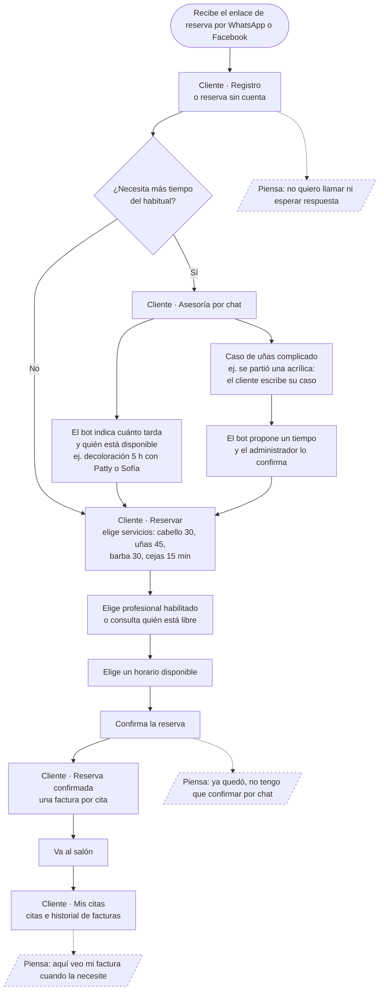
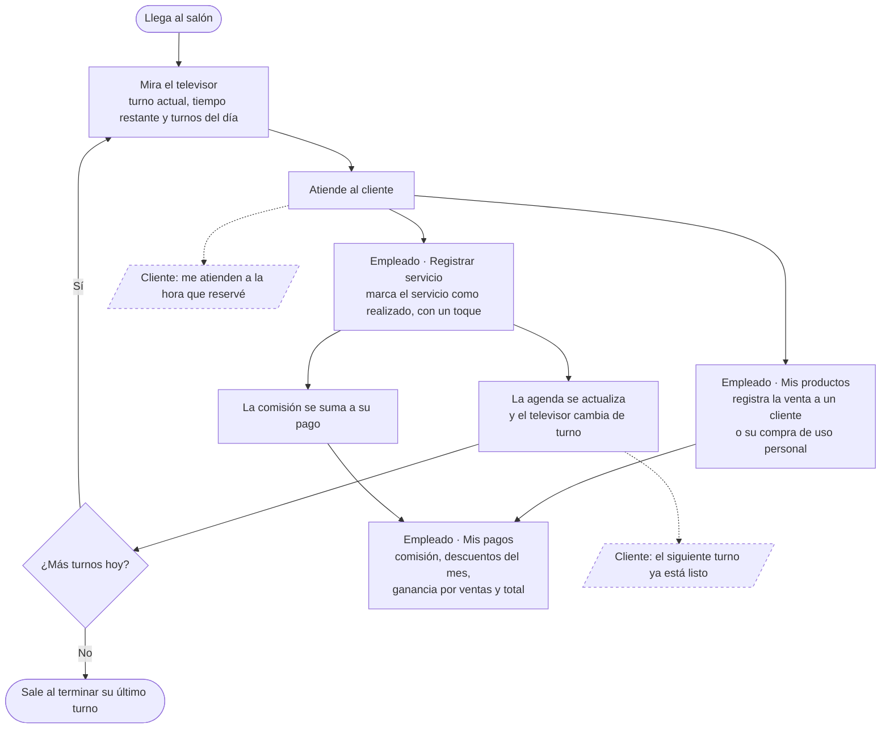
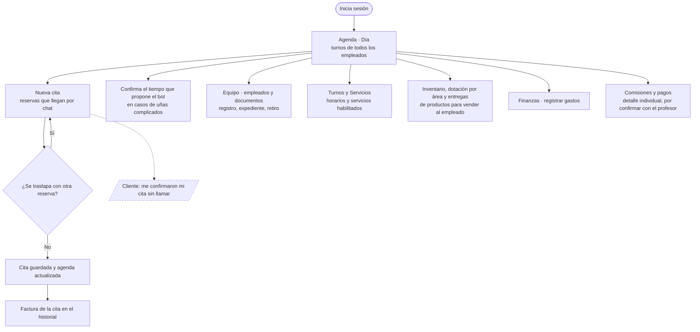
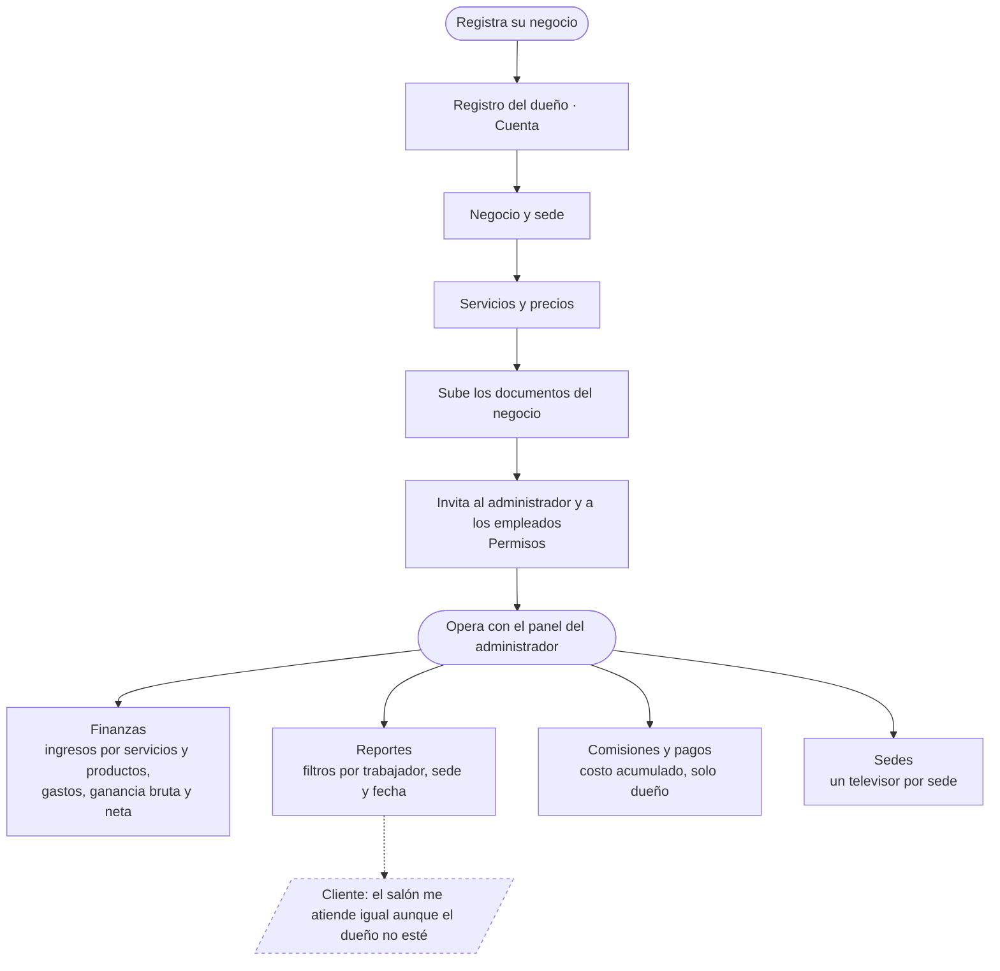

# Flujos de usuario por rol

Versión corregida con las decisiones del equipo del 23 de noviembre: catálogo reducido, duraciones fijas con asesoría por chat, agenda en televisor, factura solo como historial y empleados sin tiempo para revisar el celular.

En cada flujo, los nodos con borde punteado son **lo que vive o piensa el cliente** mientras el rol hace su trabajo. Los nombres entre corchetes son los paneles de la maqueta (carpeta [`design/`](../design)).

## 1. Cliente

## 2. Empleado

El empleado no revisa el celular durante la jornada: la información le llega en el televisor del salón.

## 3. Administrador

## 4. Dueño

