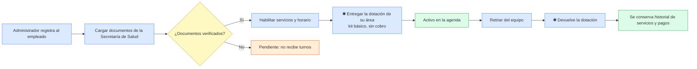
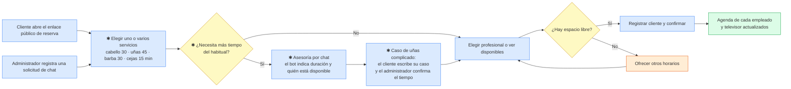
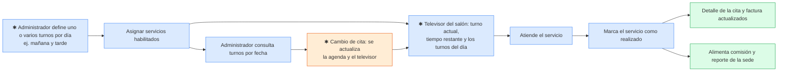
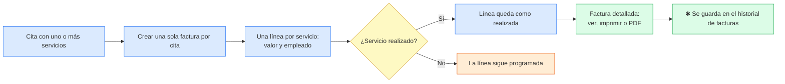
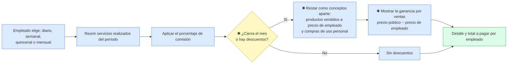
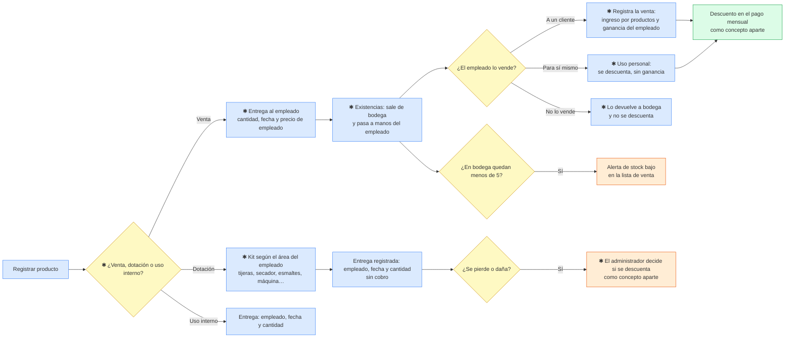
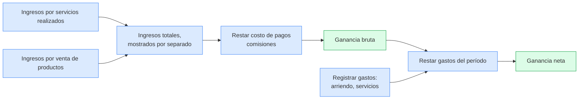
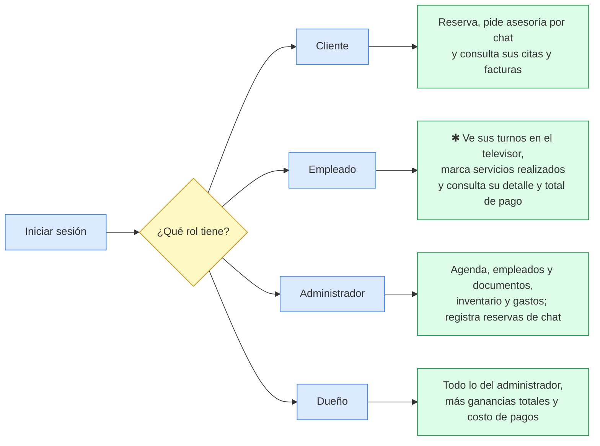

# Diagramas de flujo por módulo

Los ocho módulos del enunciado, tomados del tablero «Diagramas de flujo por módulo» y **corregidos con las decisiones del equipo del 23 de noviembre**: catálogo para cualquier cliente (cabello, uñas, barbería y cejas), duraciones fijas con asesoría por chat, varios turnos por día, agenda del empleado en el televisor, productos entregados por el gerente con descuento mensual, dotación por área, factura solo como historial y empleados sin tiempo para revisar el celular.

Colores: azul = paso, amarillo = decisión, verde = resultado, naranja = excepción. Los cambios respecto al tablero original están marcados con ✱.

Los flujos por rol, con lo que vive el cliente, están en [`flujos-de-usuario.md`](flujos-de-usuario.md).

## 1. Empleados y documentos

## 2. Clientes y reservas

✱ Se agrega la asesoría por chat para los servicios que necesitan más tiempo que el fijo. ✱ El catálogo es para cualquier cliente: cabello (corte, color, peinado: 30 min), uñas (tradicional, acrílicas, semipermanentes: 45 min), barbería (barba: 30 min) y cejas (15 min). Varios servicios se piden en una sola cita, por ejemplo corte y barba, y quedan como dos líneas de una factura.

## 3. Agenda de empleados

✱ El empleado ya no consulta el celular: ve su turno actual, el siguiente y el tiempo restante en el televisor, que se actualiza con cada cambio.

## 4. Factura

✱ Solo se guarda y muestra el **historial de facturas**; no hay integración con un proveedor de facturación electrónica.

## 5. Comisiones y pagos

✱ Cada mes se descuentan los productos que el gerente entregó al empleado para vender, a precio de empleado, y las compras de uso personal. Lo vendido a clientes le deja al empleado una ganancia: cobra el precio público y el negocio le descuenta el precio de empleado.

## 6. Inventario

✱ Tres tipos de producto: **venta**, **dotación por área** (herramientas del kit de cada área) y **uso interno** (insumos). Existencias en bodega y en manos de cada empleado.

## 7. Finanzas

Fórmulas por confirmar con el profesor; el supuesto de trabajo es bruta = ingresos − comisiones y neta = bruta − gastos.

## 8. Roles y permisos

El alcance del administrador sobre los pagos está por confirmar con el profesor.

