# Modelo de datos (borrador)

Primera propuesta derivada de los paneles y de las reglas del enunciado ([`flujo-por-panel.md`](flujo-por-panel.md)). Está pensada para un motor relacional; se recomienda PostgreSQL por la validación de traslapes entre citas.

Decisiones del equipo reflejadas aquí: una sede en la entrega pero con negocio y sede desde el inicio, catálogo para cualquier cliente (cabello, uñas, barbería y cejas), duración fija por servicio con excepciones, varios turnos por día, productos entregados al empleado con descuento mensual, dotación por área, documentos sin vencimiento, factura solo como historial y un televisor por sede.

```mermaid
erDiagram
    NEGOCIO ||--o{ SEDE : tiene
    NEGOCIO ||--o{ USUARIO : agrupa
    NEGOCIO ||--o{ SERVICIO : ofrece
    NEGOCIO ||--o{ DOCUMENTO_NEGOCIO : presenta
    SEDE ||--o{ SEDE_HORARIO : abre
    SEDE ||--o| TELEVISOR : muestra
    SEDE ||--o{ EMPLEADO : emplea
    SEDE ||--o{ CITA : recibe
    SEDE ||--o{ PRODUCTO : guarda
    SEDE ||--o{ GASTO : paga
    USUARIO ||--o| EMPLEADO : es
    USUARIO ||--o| CLIENTE : es
    EMPLEADO ||--o{ EMPLEADO_DOCUMENTO : presenta
    DOCUMENTO_REQUERIDO ||--o{ EMPLEADO_DOCUMENTO : define
    NEGOCIO ||--o{ AREA : define
    AREA ||--o{ SERVICIO : agrupa
    AREA ||--o{ AREA_DOTACION : kit
    PRODUCTO ||--o{ AREA_DOTACION : forma
    EMPLEADO ||--o{ EMPLEADO_AREA : pertenece
    AREA ||--o{ EMPLEADO_AREA : incluye
    EMPLEADO ||--o{ EMPLEADO_SERVICIO : habilitado
    SERVICIO ||--o{ EMPLEADO_SERVICIO : habilita
    EMPLEADO ||--o{ TURNO_EMPLEADO : trabaja
    EMPLEADO ||--|| COMISION_CONFIG : cobra
    CLIENTE ||--o{ CITA : reserva
    CITA ||--|{ CITA_SERVICIO : incluye
    SERVICIO ||--o{ CITA_SERVICIO : es
    EMPLEADO ||--o{ CITA_SERVICIO : presta
    CITA ||--|| FACTURA : genera
    SERVICIO ||--o{ ASESORIA_REGLA : tiene
    CLIENTE ||--o{ ASESORIA_CHAT : abre
    ASESORIA_CHAT ||--o{ ASESORIA_MENSAJE : contiene
    EMPLEADO ||--o{ LIQUIDACION : recibe
    LIQUIDACION ||--|{ LIQUIDACION_DETALLE : detalla
    CITA_SERVICIO ||--o| LIQUIDACION_DETALLE : origina
    PRODUCTO ||--o{ ENTREGA_INTERNA : sale
    EMPLEADO ||--o{ ENTREGA_INTERNA : recibe
    ENTREGA_INTERNA ||--o| LIQUIDACION_DETALLE : descuenta
    PRODUCTO ||--o{ VENTA_PRODUCTO : vende
    EMPLEADO ||--o{ VENTA_PRODUCTO : registra
    ENTREGA_INTERNA ||--o{ VENTA_PRODUCTO : origina
    VENTA_PRODUCTO ||--o| LIQUIDACION_DETALLE : descuenta

    NEGOCIO { int id PK
        string nombre
        string nit }
    SEDE { int id PK
        int negocio_id FK
        string nombre
        string direccion }
    DOCUMENTO_NEGOCIO { int id PK
        int negocio_id FK
        string nombre
        string archivo
        date subido_en }
    SEDE_HORARIO { int id PK
        int sede_id FK
        int dia_semana
        time apertura
        time cierre }
    TELEVISOR { int id PK
        int sede_id FK
        string codigo }
    USUARIO { int id PK
        int negocio_id FK
        string correo
        string clave_hash
        string rol "cliente, empleado, administrador, dueno" }
    CLIENTE { int id PK
        int usuario_id FK
        string nombres
        string celular }
    EMPLEADO { int id PK
        int usuario_id FK
        int sede_id FK
        string nombres
        string documento
        boolean activo }
    DOCUMENTO_REQUERIDO { int id PK
        string nombre
        boolean obligatorio }
    EMPLEADO_DOCUMENTO { int id PK
        int empleado_id FK
        int documento_requerido_id FK
        string archivo
        date subido_en
        string estado "pendiente, verificado" }
    AREA { int id PK
        int negocio_id FK
        string nombre "cabello, unas, barberia, cejas" }
    EMPLEADO_AREA { int empleado_id PK
        int area_id PK }
    AREA_DOTACION { int id PK
        int area_id FK
        int producto_id FK
        int cantidad "piezas del kit del area" }
    SERVICIO { int id PK
        int negocio_id FK
        int area_id FK
        string nombre "corte, color, peinado, tradicional, acrilicas, semipermanentes, barba, cejas"
        int duracion_min "30 cabello y barba, 45 unas, 15 cejas"
        decimal precio }
    EMPLEADO_SERVICIO { int empleado_id PK
        int servicio_id PK }
    TURNO_EMPLEADO { int id PK
        int empleado_id FK
        int dia_semana
        time inicio
        time fin "varios turnos por dia, sin cruzarse" }
    COMISION_CONFIG { int empleado_id PK
        decimal porcentaje
        string periodicidad "diario, semanal, quincenal, mensual" }
    CITA { int id PK
        int sede_id FK
        int cliente_id FK
        date fecha
        string origen "enlace, whatsapp, administrador"
        string estado }
    CITA_SERVICIO { int id PK
        int cita_id FK
        int servicio_id FK
        int empleado_id FK
        datetime inicio
        datetime fin
        decimal valor
        string estado "programado, en curso, realizado, cancelado" }
    FACTURA { int id PK
        int cita_id FK
        int numero
        decimal total
        datetime emitida_en }
    ASESORIA_REGLA { int id PK
        int servicio_id FK
        string motivo "ej. decoloracion"
        int duracion_min "ej. 300" }
    ASESORIA_CHAT { int id PK
        int cliente_id FK
        string tipo "tiempo o caso de unas"
        int duracion_propuesta_min
        string estado "abierto, confirmado por administrador" }
    ASESORIA_MENSAJE { int id PK
        int chat_id FK
        string autor "bot o cliente"
        string texto }
    LIQUIDACION { int id PK
        int empleado_id FK
        date desde
        date hasta
        decimal total
        string estado "pendiente, pagado" }
    LIQUIDACION_DETALLE { int id PK
        int liquidacion_id FK
        string tipo "comision, descuento_venta, descuento_personal, descuento_dotacion"
        int cita_servicio_id FK
        int venta_producto_id FK
        int entrega_interna_id FK
        decimal valor }
    PRODUCTO { int id PK
        int sede_id FK
        string nombre
        string tipo "venta, dotacion, uso_interno"
        int existencias_bodega
        decimal precio_publico "solo venta"
        decimal precio_empleado "solo venta" }
    ENTREGA_INTERNA { int id PK
        int producto_id FK
        int empleado_id FK
        date fecha
        int cantidad
        string tipo "dotacion, venta, uso_interno"
        decimal precio_unitario "precio de empleado si es venta"
        int devueltas }
    VENTA_PRODUCTO { int id PK
        int producto_id FK
        int empleado_id FK
        int entrega_interna_id FK
        int cliente_id FK
        date fecha
        int cantidad
        string destino "cliente, uso_personal, mostrador"
        decimal precio_cobrado
        decimal precio_empleado }
    GASTO { int id PK
        int sede_id FK
        string concepto "arriendo, servicios, otros"
        decimal valor
        date fecha }
```

## Reglas que el modelo debe garantizar

- **Una factura por cita:** `factura.cita_id` es único; cada servicio es una línea (`cita_servicio`) con su valor y su empleado.
- **Sin traslapes:** un empleado no puede tener dos `cita_servicio` cuyo intervalo `inicio`–`fin` se cruce.
- **Duración:** el valor por defecto sale de `servicio.duracion_min`; los casos especiales salen de `asesoria_regla` o de un caso de uñas confirmado por el administrador.
- **Inventario:** los productos de venta con `existencias_bodega < 5` aparecen en la alerta; cada `entrega_interna` guarda empleado, fecha, cantidad y tipo (dotación, venta o uso interno). Lo que un empleado tiene en mano es lo entregado para vender menos lo vendido, lo de uso personal y lo devuelto.
- **Dotación por área:** `area_dotacion` define el kit de cada área; al registrar a un empleado se entrega el kit de su(s) `empleado_area`. No se cobra; si se pierde o daña, el administrador decide si genera una línea `descuento_dotacion`.
- **Venta de productos:** el negocio entrega al empleado a `precio_empleado`; el empleado cobra al cliente `precio_publico` y se queda con la diferencia. Al cierre del mes se descuenta (`descuento_venta`) lo vendido a precio de empleado y lo de uso personal (`descuento_personal`, sin ganancia); lo devuelto no se descuenta. El ingreso del negocio por productos es el precio de empleado de lo vendido más las ventas de mostrador.
- **Turnos:** una persona puede tener varios `turno_empleado` el mismo día, siempre que no se crucen; una cita solo puede caer dentro de un turno.
- **Catálogo:** los servicios no dependen del género del cliente; una cita puede combinar servicios de varias áreas (por ejemplo corte y barba).
- **Finanzas:** ganancia bruta = ingresos (facturas + ventas de productos) − comisiones; ganancia neta = bruta − gastos. Los ingresos por servicios y por productos se muestran por separado.
- **Pagos:** la comisión de un servicio realizado se suma a la `liquidacion` del periodo que elige el empleado; los descuentos por productos son líneas separadas (`descuento_venta`, `descuento_personal`).
- **Permisos:** el administrador ve el detalle individual de pagos; el costo acumulado es del dueño (por confirmar con el profesor).

## Por confirmar

Los supuestos abiertos del [levantamiento](levantamiento-de-informacion.md) cambian este modelo: comisión por empleado o por servicio, documentos que pide la Secretaría de Salud, si un empleado puede atender dos clientes a la vez, y las cuatro reglas de productos (qué se descuenta si no se vende, quién cobra al cliente, cuándo se descuenta y si la dotación perdida se cobra).
