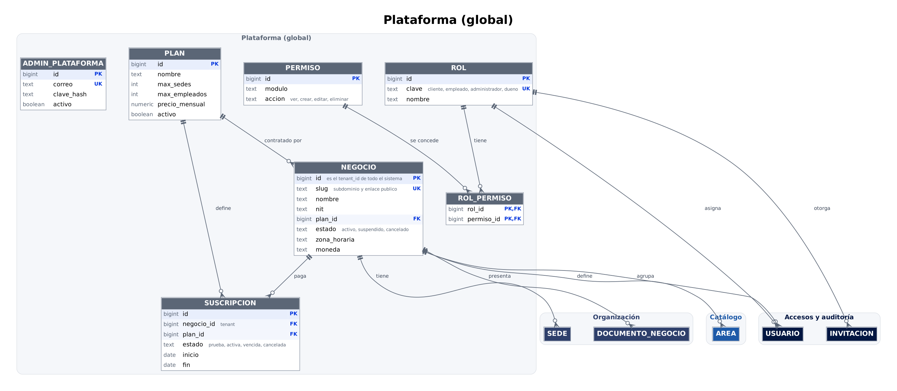
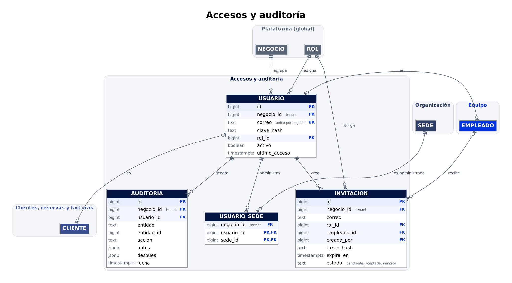
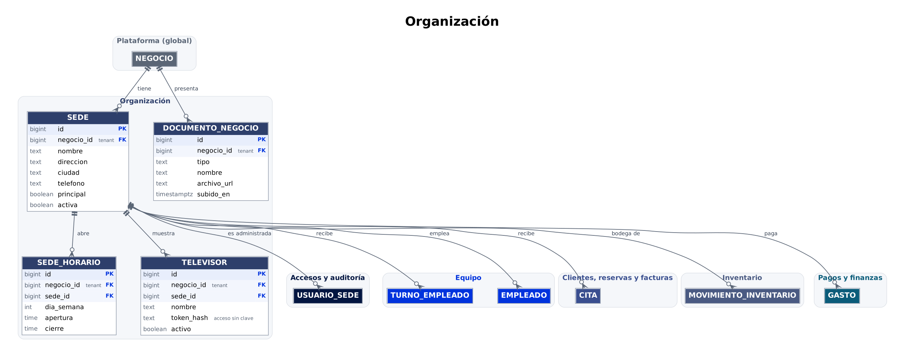
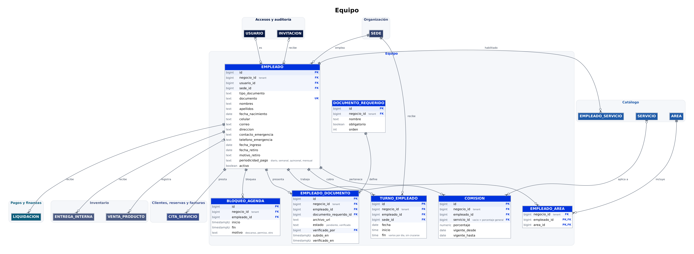
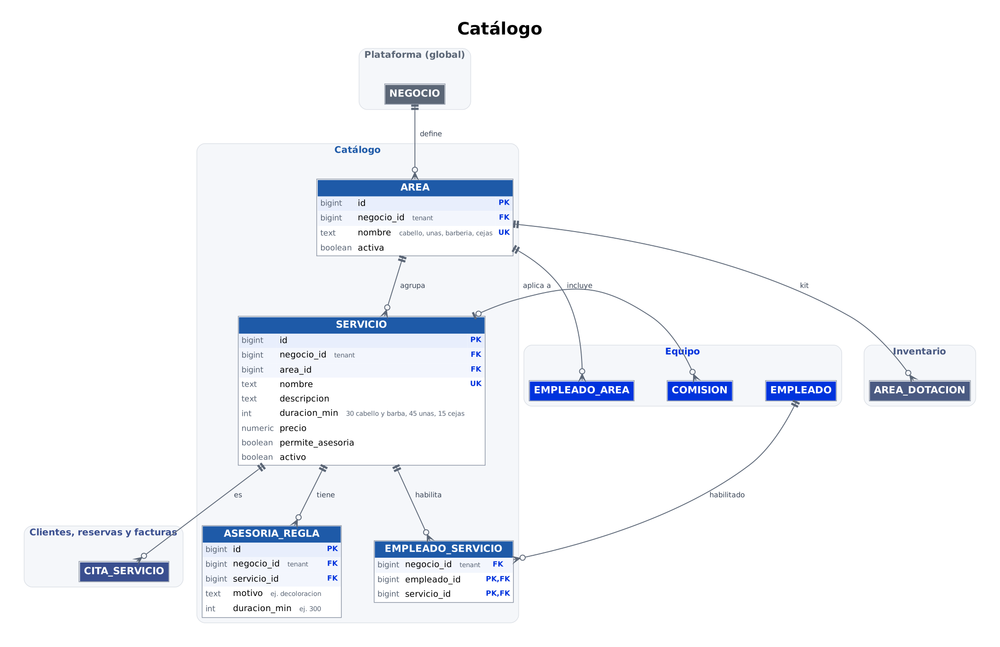
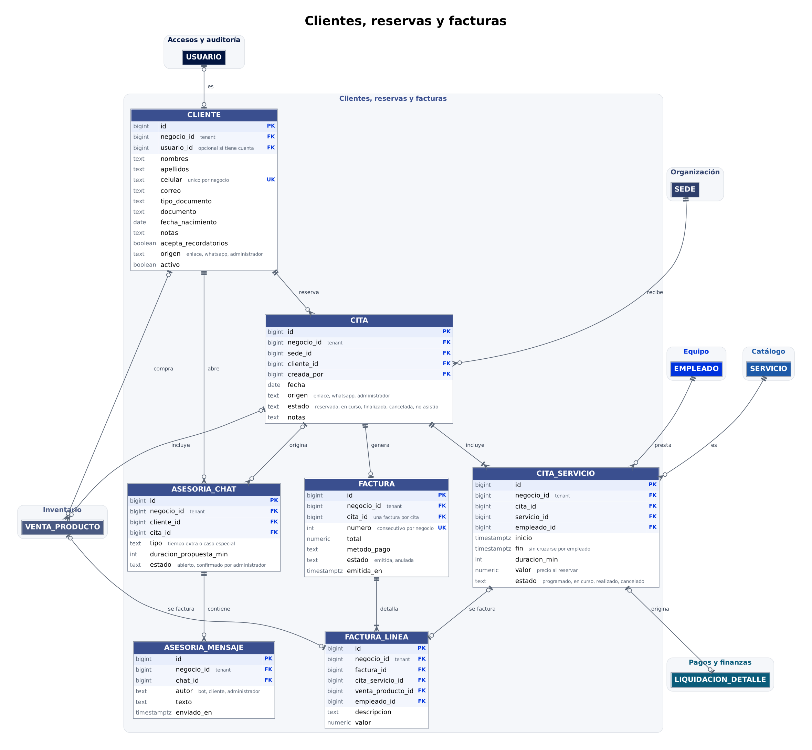
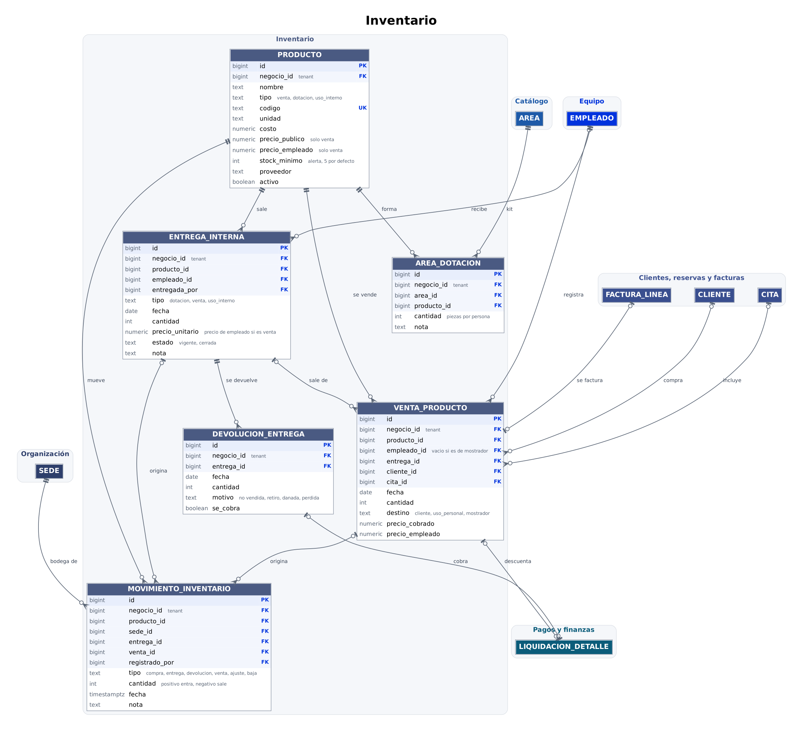
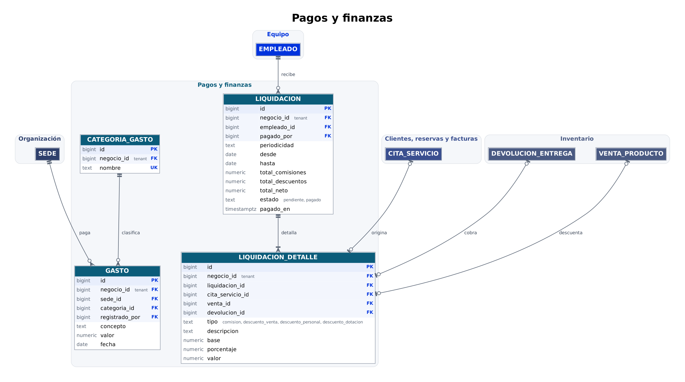

# Modelo de datos multi-tenant (borrador 2)

Diseño de la base de datos de Citara para atender a muchos negocios (peluquerías, salones de uñas y barberías) desde una sola instalación. Está pensado para PostgreSQL. Se diseña antes del script de creación: cuando el equipo lo apruebe, de aquí sale el SQL.

Deriva de los paneles ([`flujo-por-panel.md`](flujo-por-panel.md)), de las reglas del enunciado y de las decisiones del equipo: catálogo de cuatro áreas para cualquier cliente, varios turnos por día, productos entregados al empleado con descuento mensual, dotación por área y documentos sin vencimiento.

## 1. Estrategia multi-tenant: pool

**Pool** significa una sola base de datos y un solo esquema compartidos por todos los negocios. Cada negocio es un **tenant** y cada fila de datos dice a cuál pertenece mediante la columna `negocio_id`.

| Opción | Qué es | Por qué sí o no |
|---|---|---|
| **Pool (elegida)** | Una base y un esquema; `negocio_id` en cada tabla | Barato de operar, una sola migración para todos, fácil dar de alta un negocio nuevo. Exige disciplina para aislar los datos. |
| Un esquema por negocio | Mismas tablas copiadas por negocio | Mejor aislamiento, pero cada migración se repite N veces. |
| Una base por negocio | Aislamiento total | Costoso y difícil de operar con muchos negocios pequeños. |

Se elige pool porque los clientes son negocios pequeños, hay que dar de alta muchos y el equipo necesita una sola migración. El riesgo es que una consulta mal escrita mezcle datos de dos negocios, y por eso el aislamiento se garantiza **en la base de datos**, no solo en la aplicación.

### Cómo se aísla un negocio de otro

1. **`negocio_id` obligatorio.** Toda tabla de negocio lo lleva como `NOT NULL` y con llave foránea a `negocio.id`.
2. **Llaves foráneas compuestas.** Cada tabla de negocio tiene `UNIQUE (negocio_id, id)`. Las tablas hijas referencian `(negocio_id, padre_id)` y no solo `padre_id`. Así una cita nunca puede apuntar al cliente de otro negocio, aunque la aplicación se equivoque.
3. **Row Level Security (RLS).** Cada tabla de negocio tiene una política `negocio_id = current_setting('app.negocio_id')::bigint`.
4. **Contexto por transacción.** Con un pool de conexiones, cada transacción ejecuta primero `SET LOCAL app.negocio_id = <id>`. `SET LOCAL` se borra al terminar la transacción, así una conexión reutilizada nunca arrastra el negocio anterior.
5. **Rol de base de datos sin privilegios.** La aplicación se conecta con un rol sin `BYPASSRLS` y que no es dueño de las tablas. Las migraciones usan otro rol.
6. **Únicos por negocio.** Los campos únicos lo son dentro del negocio: `UNIQUE (negocio_id, correo)`, `UNIQUE (negocio_id, numero)` de factura, `UNIQUE (negocio_id, celular)` de cliente.
7. **Índices que empiezan por `negocio_id`.** Por ejemplo `(negocio_id, fecha)` en citas.
8. **Pruebas de fuga.** Una prueba automática crea dos negocios y comprueba que ninguna consulta de uno ve filas del otro.

### Qué es global y qué es de cada negocio

| Tipo | Tablas | Regla |
|---|---|---|
| **Globales** (sin `negocio_id`) | `plan`, `rol`, `permiso`, `rol_permiso`, `admin_plataforma` | Las administra el equipo de Citara. Sin RLS; solo lectura para la aplicación. |
| **Raíz del tenant** | `negocio` | Su `id` es el `tenant_id` de todo el sistema. |
| **De cada negocio** | Todas las demás, incluida `suscripcion` | Llevan `negocio_id` y RLS. |

### Cómo se identifica el negocio en cada petición

- **Sitio público de reservas:** por el `slug` del negocio, por ejemplo `citara.app/salon-aurora`.
- **Usuarios del panel:** el inicio de sesión se hace dentro del negocio (mismo `slug`). El correo es único **por negocio**, así una misma persona puede tener cuenta en dos negocios distintos.
- **Televisor:** un enlace con `token` propio que identifica negocio y sede, sin iniciar sesión.
- **Administración de la plataforma:** `admin_plataforma` entra por separado y puede ver todos los negocios.

### Vida de un negocio

- **Alta:** se crea `negocio`, su `suscripcion`, la sede principal y el usuario dueño. Se cargan las plantillas: las cuatro áreas, el catálogo de servicios, la lista de documentos requeridos y las categorías de gasto.
- **Límites por plan:** `plan.max_sedes` y `plan.max_empleados` se validan al crear sedes y empleados.
- **Suspensión:** `negocio.estado = 'suspendido'` bloquea el acceso y conserva los datos.
- **Exportación y baja:** se puede exportar todo un negocio filtrando por `negocio_id`. El borrado definitivo se hace después de un plazo y de forma explícita.

## 2. Convenciones

- **Nombres:** tablas en singular y en minúsculas con guion bajo (`cita_servicio`); llaves foráneas `<tabla>_id`.
- **Llave primaria:** `id bigint generated always as identity`. En las tablas puente la llave es compuesta.
- **Fechas:** `timestamptz` guardado en UTC; cada negocio tiene su `zona_horaria` para mostrarlo. `date` y `time` solo para turnos y horarios.
- **Dinero:** `numeric(12,2)` en la moneda del negocio. Los precios se **copian** en la cita y en la venta para que un cambio de precio no altere el historial.
- **Columnas de auditoría** (no se dibujan para no saturar el diagrama): `creado_en`, `actualizado_en` en todas las tablas.
- **Borrado:** no se borra lo que tiene historial; se marca `activo = false` o con fecha de retiro.
- **Textos con valores fijos** (`estado`, `tipo`): `text` con `CHECK`, para poder cambiarlos con una migración simple.
- **Auditoría:** `auditoria` registra quién cambió qué en datos sensibles (pagos, precios, documentos, retiros).

## 3. Modelo entidad-relación

Cada tabla muestra sus campos con `PK` (llave primaria), `FK` (llave foránea) y `UK` (única dentro del negocio). `negocio_id` aparece en todas las tablas de negocio con la nota «tenant», **pero no se dibuja su línea hacia `negocio`** para que el diagrama se pueda leer. Solo se dibujan las relaciones del negocio con sus tablas principales. Las relaciones usan patas de gallo: la pata es «muchos», la raya «uno» y el círculo «opcional».

La imagen es grande. Ábrela y acércate, o usa la versión vectorial [`00-modelo-er-completo.svg`](er/00-modelo-er-completo.svg), que se amplía sin perder calidad. Para ver solo las relaciones, sin campos, está el [mapa de relaciones](er/00b-mapa-de-relaciones.png).

### Por módulos

**1. Plataforma (global)**

**2. Accesos y auditoría**

**3. Organización**

**4. Equipo**

**5. Catálogo**

**6. Clientes, reservas y facturas**

**7. Inventario**

**8. Pagos y finanzas**

Para regenerar las imágenes después de cambiar el modelo, edita [`er/modelo-er.mmd`](er/modelo-er.mmd) y ejecuta `python3 docs/er/generar.py` (necesita Graphviz).

## 4. Diccionario de tablas

### Plataforma (global)

| Tabla | Para qué sirve | Claves y reglas |
|---|---|---|
| `plan` | Planes que se venden: límites de sedes y empleados, precio mensual. | |
| `negocio` | El tenant. Su `slug` forma el enlace público; guarda zona horaria y moneda. | `slug` único en toda la plataforma. |
| `suscripcion` | Historial de planes contratados por un negocio. | Una sola vigente por negocio. |
| `rol`, `permiso`, `rol_permiso` | Cliente, empleado, administrador y dueño, y qué puede hacer cada uno por módulo. | Catálogo común a todos los negocios. |
| `admin_plataforma` | Equipo de Citara que administra los negocios. | |

### Accesos y auditoría

| Tabla | Para qué sirve | Claves y reglas |
|---|---|---|
| `usuario` | Cuenta de acceso de cliente, empleado, administrador o dueño. | `UNIQUE (negocio_id, correo)`. |
| `usuario_sede` | A qué sedes puede entrar un administrador. | Llave compuesta. |
| `invitacion` | Invitación por correo para que un empleado cree su contraseña. | `token_hash` único; vence. |
| `auditoria` | Quién hizo qué y con qué valores antes y después. | Solo se inserta. |

### Organización

| Tabla | Para qué sirve | Claves y reglas |
|---|---|---|
| `sede` | Cada local del negocio. | Una marcada como `principal`. |
| `sede_horario` | Horario de atención por día de la semana. | |
| `televisor` | Pantalla del salón que muestra los turnos del día. | Acceso por `token_hash`, sin clave. |
| `documento_negocio` | Documentos del negocio (cámara de comercio, permisos). | |

### Equipo

| Tabla | Para qué sirve | Claves y reglas |
|---|---|---|
| `empleado` | Datos personales, de contacto, de emergencia, ingreso, retiro y periodicidad de pago elegida. | `UNIQUE (negocio_id, documento)`. El retiro no borra el historial. |
| `empleado_area` | Áreas en las que trabaja; de ahí sale su dotación. | |
| `documento_requerido` | Lista configurable de documentos que debe presentar cada empleado. | |
| `empleado_documento` | Documento subido por un empleado y su estado (pendiente o verificado). **No vence.** | Uno por empleado y documento requerido. |
| `turno_empleado` | Turnos por fecha. Una persona puede tener varios el mismo día. | Dos turnos de una persona no se cruzan. |
| `bloqueo_agenda` | Descansos o permisos que cierran la agenda de un empleado. | No se cruza con citas. |
| `comision` | Porcentaje de comisión del empleado: general o por servicio, con vigencia. | Si `servicio_id` está vacío es el porcentaje general. |

### Catálogo

| Tabla | Para qué sirve | Claves y reglas |
|---|---|---|
| `area` | Cabello, uñas, barbería y cejas; cada negocio puede ajustarlas. | `UNIQUE (negocio_id, nombre)`. |
| `servicio` | Servicio con duración fija y precio. No depende del género del cliente. | `UNIQUE (negocio_id, nombre)`. |
| `empleado_servicio` | Servicios que cada empleado puede prestar. | Llave compuesta. |
| `asesoria_regla` | Servicios que necesitan más tiempo que el fijo y su duración, por chat. | |

### Clientes, reservas y facturas

| Tabla | Para qué sirve | Claves y reglas |
|---|---|---|
| `cliente` | Persona que reserva; puede tener cuenta o ser registrada por el administrador. | `UNIQUE (negocio_id, celular)`. |
| `cita` | Reserva de un cliente en una fecha. Reúne uno o varios servicios. | |
| `cita_servicio` | Cada servicio de la cita con su empleado, horas, duración y precio al reservar. | Sin cruces por empleado. |
| `asesoria_chat`, `asesoria_mensaje` | Chat de asesoría para servicios especiales o más largos. | |
| `factura` | Historial de la cita, no factura electrónica. Una por cita. | `UNIQUE (negocio_id, cita_id)` y `UNIQUE (negocio_id, numero)`. |
| `factura_linea` | Cada servicio o producto facturado, con su valor y su empleado. | Cada línea apunta a un servicio o a una venta, no a ambos. |

### Inventario

| Tabla | Para qué sirve | Claves y reglas |
|---|---|---|
| `producto` | Producto de **venta**, pieza de **dotación** o insumo de **uso interno**. Guarda costo, precio público y precio de empleado. | `UNIQUE (negocio_id, codigo)`. Los precios solo aplican a los de venta. |
| `movimiento_inventario` | Cada entrada y salida de bodega por sede. Las existencias salen de sumarlos. | Positivo entra, negativo sale. |
| `area_dotacion` | Kit básico de cada área: qué piezas y cuántas recibe cada persona. | |
| `entrega_interna` | Lo que el negocio entrega a un empleado: dotación, productos para vender o uso interno. | El precio unitario es el de empleado cuando es venta. |
| `devolucion_entrega` | Lo que el empleado devuelve: producto sin vender, dotación al retirarse, pieza dañada o perdida. | `se_cobra` lo decide el administrador. |
| `venta_producto` | Venta a un cliente, compra de uso personal o venta de mostrador. | Guarda el precio cobrado y el precio de empleado. |

### Pagos y finanzas

| Tabla | Para qué sirve | Claves y reglas |
|---|---|---|
| `liquidacion` | Pago de un empleado en un período (diario, semanal, quincenal o mensual). | `UNIQUE (negocio_id, empleado_id, desde, hasta)`. |
| `liquidacion_detalle` | Cada comisión y cada descuento, como línea aparte. | Tipos: comisión, descuento por venta, por uso personal y por dotación. |
| `categoria_gasto`, `gasto` | Gastos del negocio por sede y categoría. | |

## 5. Reglas que el modelo debe garantizar

| Regla | Cómo se garantiza |
|---|---|
| Nada se cruza entre negocios | `negocio_id` obligatorio, llaves foráneas compuestas y RLS (sección 1). |
| Una factura por cita | `UNIQUE (negocio_id, cita_id)` en `factura`. |
| Sin cruces de un empleado | `EXCLUDE USING gist (negocio_id WITH =, empleado_id WITH =, tstzrange(inicio, fin) WITH &&)` en `cita_servicio` (extensión `btree_gist`). |
| Turnos del mismo día sin cruzarse | Restricción de exclusión parecida en `turno_empleado`. |
| La cita cae dentro de un turno del empleado y de un servicio habilitado | Validación al reservar, con `turno_empleado` y `empleado_servicio`. |
| Una cita agrupa servicios de varias áreas | `cita_servicio` es 1 a muchos con `cita`; cada uno con su empleado. |
| Duración fija con excepciones | `servicio.duracion_min`; las excepciones salen de `asesoria_regla` y de `asesoria_chat.duracion_propuesta_min`. |
| Existencias | No se guardan: salen de sumar `movimiento_inventario` (vistas de la sección 6). |
| Alerta de stock bajo | Producto de venta con existencias en bodega por debajo de `stock_minimo` (5 por defecto). |
| Venta de productos | Se entrega al empleado a `precio_empleado`; el empleado cobra `precio_publico` al cliente y se queda con la diferencia. |
| Descuento mensual | Al cerrar el mes se crea una línea `descuento_venta` por lo vendido y `descuento_personal` por el uso propio, a precio de empleado. Lo devuelto sin vender no se descuenta. |
| Dotación | Se entrega según el área del empleado y no se cobra. Si se pierde o daña, el administrador decide `se_cobra` y se crea `descuento_dotacion`. |
| Comisión | Porcentaje vigente del empleado (por servicio si existe, si no el general) sobre el valor de `cita_servicio` realizado. |
| Finanzas | Ganancia bruta = ingresos (servicios + productos) − comisiones; ganancia neta = bruta − gastos. |
| Documentos | Se guardan y se ven todos juntos; nunca se marcan como vencidos. |
| Los precios no cambian el pasado | Se copian `valor` y `precio_*` en la cita y en la venta. |

## 6. Vistas derivadas previstas

| Vista | Qué entrega |
|---|---|
| `v_existencia_bodega` | Existencias por producto y sede: suma de `movimiento_inventario`. |
| `v_stock_bajo` | Productos de venta por debajo del mínimo; alimenta la alerta del inventario. |
| `v_en_mano_empleado` | Lo que cada empleado tiene en mano: entregado − vendido − uso personal − devuelto. |
| `v_agenda_dia` | Turnos y citas del día por empleado y sede; la usa el televisor. |
| `v_estado_dotacion` | Si cada empleado tiene su kit completo o le falta alguna pieza. |
| `v_ganancia_empleado` | Ganancia por ventas de cada empleado en el mes. |

## 7. De qué pantalla sale cada tabla

El detalle de lecturas y escrituras de cada pantalla está en [`flujo-por-panel.md`](flujo-por-panel.md). Resumen de las pantallas nuevas:

| Pantalla | Escribe en |
|---|---|
| Nuevo cliente | `cliente` (y `usuario` si se le crea acceso) |
| Crear servicio | `servicio`, `empleado_servicio`, `comision`, `asesoria_regla` |
| Nueva pieza de dotación | `producto` (tipo dotación), `area_dotacion` |
| Nuevo producto | `producto`, `movimiento_inventario` (existencias iniciales) |
| Expediente del empleado | `empleado`, `empleado_area`, `empleado_documento`, `turno_empleado`, `empleado_servicio`, `comision`, `entrega_interna`, `devolucion_entrega` |

## 8. Por confirmar

- **Motor:** se asume PostgreSQL por RLS, `EXCLUDE` e `identity`. Si el curso exige otro motor (MySQL, SQL Server), cambian las políticas de aislamiento y las restricciones de cruce.
- **Un usuario en varios negocios:** hoy el correo es único por negocio, así que una persona con dos negocios tiene dos cuentas. Si se quiere una sola cuenta, se agrega una tabla global de identidades.
- **Comisión:** si es un porcentaje por empleado o varía por servicio. El modelo soporta las dos.
- **Productos:** qué se descuenta si no se vende, quién cobra al cliente, cuándo se descuenta cuando el pago no es mensual, y si la dotación perdida se cobra.
- **Documentos:** cuáles exige en la práctica la Secretaría de Salud.
- **Facturación electrónica:** queda fuera; `factura` es solo historial.
- **Planes:** valores y límites de cada plan.
